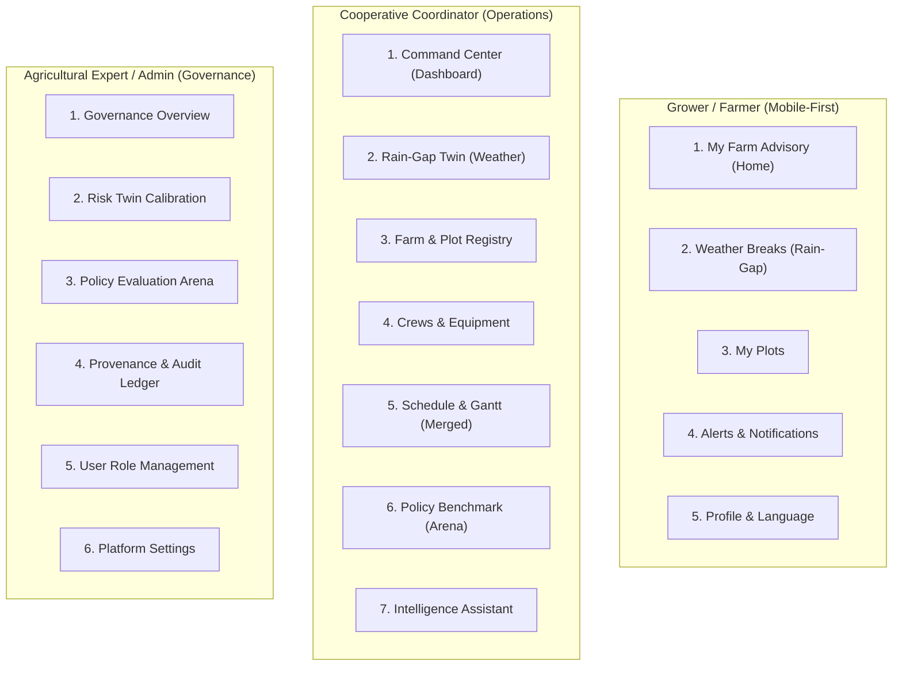

# MahaliShield UI Content & Information Architecture Audit

**Audit Date:** November 19, 2026  
**Scope:** Entire MahaliShield Frontend Application (`frontend/src`)  
**Mode:** Read-Only Content & Information Architecture Review  
**Auditor:** Antigravity AI Assistant  

---

## Executive Summary

MahaliShield possesses strong operational, mathematical, and agronomic foundations, combining Open-Meteo ensemble rainfall forecasting, state-space disease risk proxies, and Google OR-Tools CP-SAT scheduling. However, the current user interface suffers from severe information fragmentation, widespread redundancy, and a complete lack of role-based view differentiation.

Currently, **all 3 user roles (Grower, Coordinator, Expert) see the exact same 13-item navigation sidebar** and can access all technical engineering pages. A smallholder arecanut grower on a mobile phone is presented with OR-Tools constraint matrices, solver telemetry, and cluster-wide equipment failure simulators. Conversely, operational coordinators must jump across four separate pages (`/planner`, `/gantt`, `/replanning`, `/policy-arena`) to accomplish a single scheduling workflow. Furthermore, critical disclaimers and metadata are repeated up to six times across different screens, while internal solver variables (such as random seeds, input hashes, and internal slot integers) clutter primary decision views.

This audit provides a complete element-by-element inventory of all 14 application screens and outlines a concrete roadmap to streamline the application into focused, role-specific experiences.

---

## A. Page Inventory

### 1. Authentication Page (`/login`)
- **Route:** `/login` (with optional `?tabs=true` sub-view)
- **Role(s) with Access:** Public (Unauthenticated visitors)
- **One Decision / Task:** Authenticate the user into the system by role and credentials (or initiate registration/password recovery).

| Element | What it shows | Data Source / Component | Verdict | Reason |
| :--- | :--- | :--- | :--- | :--- |
| **Header Logo & Wordmark** | MahaliShield icon and title | Static SVG / `AuthPage.tsx` | **KEEP** | Essential brand identity. |
| **Headline H1 & Subline** | "Win the gaps between the rains." + description | Static text / `AuthPage.tsx` | **KEEP** | Core value proposition statement. |
| **Role Card: Coordinator** | Card 01 with description, cover image, and sign-in flip | `ROLES[0]` / `AuthPage.tsx` | **KEEP** | Primary coordinator entry point. |
| **Role Card: Grower** | Card 02 with Kannada/English advisory copy, image, and flip | `ROLES[1]` / `AuthPage.tsx` | **KEEP** | Primary grower entry point. |
| **Role Card: Expert** | Card 03 with governance/audit copy, image, and flip | `ROLES[2]` / `AuthPage.tsx` | **KEEP** | Primary expert entry point. |
| **Flipped Card Back Face** | Email, password input, sign-in button, error alert | State in `AuthPage.tsx` | **KEEP** | High-speed 1-click demo login. |
| **Footer Disclaimer** | "Synthetic demo data · Simulated exposure, not disease probability" | Static text / `AuthPage.tsx` | **KEEP** | Mandatory epistemic disclaimer before login. |
| **Legacy Tabs Sub-view (`?tabs=true`)** | Multi-tab login/register/reset form with role radio buttons | `AuthPage.tsx` lines 270–400 | **MERGE** | Duplicate authentication form; integrate registration/reset into back-face modal instead of a separate screen. |

---

### 2. Operational Command Center (`/`)
- **Route:** `/`
- **Role(s) with Access:** Currently all roles (Coordinator, Grower, Expert); recommended exclusively for **Coordinator**.
- **One Decision / Task:** Assess real-time cluster protection posture and dispatch crews to the highest-risk plots before rainfall returns.

| Element | What it shows | Data Source / Component | Verdict | Reason |
| :--- | :--- | :--- | :--- | :--- |
| **Role Image Band** | 380px hero banner with role image, cluster pill, simulated badge, language, notifications, and title | `DashboardPage.tsx` lines 126–208 | **KEEP (Refactor)** | Strong visual anchor, but title is hardcoded to "Coordinator Command Center" even when logged in as Farmer or Admin. |
| **Top Bar Simulated Badge** | "SIMULATED RESULT — NOT DISEASE PROBABILITY" | `t(lang, 'simulated_badge')` | **KEEP** | Canonical top-level disclaimer. |
| **Cluster Pill** | "Thirthahalli Cluster · Shivamogga, KA" | Static text in header | **KEEP** | Crucial geographic context. |
| **Action Row** | Refresh, "Run CP-SAT Optimizer", "Dynamic Replanning" | Buttons / Links in `DashboardPage.tsx` | **MERGE** | Actions should live near the schedule table or planner section, not floating between header and KPIs. |
| **KPI Strip: Monitored Plots** | "8 plots · 4 farms · 19 ac" | `data.counts` | **KEEP** | Core operational scale stat. |
| **KPI Strip: Available Crews** | "4/4 crews · 4 equipment units" | `data.counts` | **KEEP** | Critical capacity metric. |
| **KPI Strip: Plots Requiring Attention** | "6 plots · 8 pending operations" (amber) | `data.counts` | **KEEP** | Direct anchor link to Priority Queue. |
| **KPI Strip: Next Dry Window** | "+3h to +11h · Peak dry prob 80% · rain return 22%" | `data.weather.next_dry_window` | **KEEP** | Immediate operational weather trigger. |
| **Grower Advisory Card** | Upcoming windows, highest-attention plot, next approved plan | `DashboardPage.tsx` lines 287–368 | **MOVE** | Does not belong in Coordinator dashboard; move to dedicated Grower Portal (`/grower`). |
| **Cluster Geospatial Map** | Leaflet map with color-coded exposure markers and popup | `MapContainer` / `DashboardPage.tsx` | **KEEP** | Primary spatial overview of cluster risk. |
| **Selected Plot Inspector Bar** | Name, area, priority, why prioritized, "Inspect Twin" button | State / `DashboardPage.tsx` | **KEEP** | Immediate drill-down from map click. |
| **Simulated Exposure Priority Queue** | 8 ranked plots with scores, mean/P90 exposure, and factors | `data.priority_queue` | **KEEP** | Essential dispatch queue. |
| **Priority Queue "SIMULATED RESULT" Badge** | Repetitive amber badge on card header | Static badge | **REMOVE** | Redundant with top-bar pill 200px above it. |
| **Upcoming Scheduled Operations Table** | 8 scheduled tasks with crew, window, travel, dry prob, status | `data.active_plan.assignments` | **KEEP** | Core execution schedule. |
| **Recent Activity Feed** | 5 recent audit logs with user email and timestamp | `data.recent_activity` | **REMOVE / SHRINK** | Low-value on primary operational screen; belongs in Notifications & Audit ledger. |

---

### 3. Rain-Gap Twin (`/rain-gap`)
- **Route:** `/rain-gap`
- **Role(s) with Access:** All roles; recommended for **Coordinator** and **Expert**.
- **One Decision / Task:** Identify and calibrate feasible multi-hour dry windows from ensemble weather forecasts for safe chemical application.

| Element | What it shows | Data Source / Component | Verdict | Reason |
| :--- | :--- | :--- | :--- | :--- |
| **Provenance Header Banner** | Ensemble source, model, member count, stale warning, fetch time | `statusData.active_set` / `RainGapPage.tsx` | **KEEP** | Clear provenance and data freshness. |
| **Live Fetch Button** | "Fetch Live Open-Meteo Ensemble" | POST `/forecast/refresh` | **KEEP** | On-demand weather synchronization. |
| **Replay Heavy Spell Button** | "Replay Heavy Spell (Seed 108)" | POST `/forecast/synthetic` | **MOVE** | Belongs in Expert/Admin sandbox or Demo panel, not standard operational UI. |
| **Last Live API Notice Banner** | Warning when fallback/synthetic data is active | `statusData.last_fetch_error` | **KEEP** | Critical epistemic transparency. |
| **Scenario Set Selector** | Dropdown of scenario sets | `statusData.available_sets` | **KEEP** | Allows switching historical vs live forecasts. |
| **Overlay Ensemble Member Dropdown** | Select individual scenario line (Member #0–#29) | `members` state | **MOVE** | Advanced meteorologist feature; move to collapsible advanced tray. |
| **72h Cumulative Rain Readout** | P10 / Mean / P90 total mm | `scenarioData.totals` | **KEEP** | Concise summary of forecast severity. |
| **Window Feasibility Rule Sliders** | Sliders for op hours (2h), drying (3h), max rain (0.3mm/h), min prob (60%) | Sliders state in `RainGapPage.tsx` | **KEEP** | Interactive threshold testing. |
| **Rule Summary Callout** | Plain-language explanation of active window rule | Derived text | **KEEP** | Clarifies the logic behind detected windows. |
| **Ensemble Rainfall Fan Chart** | Area chart of P10/P25/P50/P75/P90 rainfall + probability line | Recharts `ComposedChart` | **KEEP** | Flagship meteorological visualization. |
| **Cursor Readout Badges** | Cursor hour, median rain, rain-return risk % | `cursorRow` state | **KEEP** | Synchronized numerical readout. |
| **Interactive Time Slider** | 0 to 71h slider scrubbing through forecast horizon | Slider input | **KEEP** | Excellent interactive inspection control. |
| **Detected Windows Grid** | Cards for each window meeting criteria with peak dry % and rain-return risk | `windows` array | **KEEP** | Actionable list of spraying windows. |

---

### 4. Agricultural Risk & Protection Twin (`/risk-twin`)
- **Route:** `/risk-twin`
- **Role(s) with Access:** All roles; recommended for **Expert** and **Coordinator**.
- **One Decision / Task:** Understand how plot wetness, canopy density, and fungicide wash-off decay combine into relative exposure to justify plot prioritization.

| Element | What it shows | Data Source / Component | Verdict | Reason |
| :--- | :--- | :--- | :--- | :--- |
| **Model Version & Input Hash Badge** | `Version: v1.0.0-base · Hash: 7f3a8b...` | `simData.parameter_set` | **MOVE** | Cryptographic hash belongs in Governance view (`/governance`), not here. |
| **Header Title & Subtitle** | "Agricultural Risk & Protection Twin" + math description | Static text / `RiskTwinPage.tsx` | **KEEP** | Page definition. |
| **Sensitivity Selector Buttons** | Low / Base / High sensitivity buttons | `setSensitivity` state | **KEEP** | Allows rapid parameter stress-testing. |
| **Re-Run Twin Button** | Trigger simulation run | POST `/simulations` | **KEEP** | Re-computes risk trajectories. |
| **Scientific Disclaimer Banner** | Limitations callout explaining decision-support proxy scope | `simData.scientific_disclaimer` | **KEEP** | Required for scientific integrity. |
| **Plot Selector Column** | 8 ranked plots with weighted score, mean E, P90 E, and factors | `simData.priority_queue` | **KEEP** | Selects plot for trajectory inspection. |
| **State-Space Trajectory Chart** | LineChart with W(t), H(t), P(t), and E(t) over 72 hours | Recharts `LineChart` | **KEEP** | Core visual explanation of the four state variables. |
| **Explainable Prioritization Breakdown** | Bulleted factors, expected wet duration, decay percentage | `currentRank.factors` | **KEEP** | Explainable AI rationale for growers and coordinators. |
| **Active Twin Parameters Grid** | 12 parameter cards (alpha_wet, beta_dry, etc.) | `simData.parameter_set.params` | **MERGE / MOVE** | Duplicate of the table on Governance page; move full parameter listing to `/governance`. |

---

### 5. Farm & Plot Registry (`/plots`)
- **Route:** `/plots`
- **Role(s) with Access:** All roles; recommended for **Coordinator** (full CRUD) and **Grower** (own plots only).
- **One Decision / Task:** Register and update farm plot attributes (boundaries, canopy density, drainage class, and baseline protection status).

| Element | What it shows | Data Source / Component | Verdict | Reason |
| :--- | :--- | :--- | :--- | :--- |
| **Header Title & Description** | "Farm & Plot Registry" + summary | Static text / `PlotsPage.tsx` | **KEEP** | Clear registry context. |
| **Add Farm Plot Button** | Opens modal with map coordinate picker | `setModalOpen(true)` | **KEEP** | Essential creation workflow. |
| **Search Bar & Filters** | Search input + Priority dropdown + Status dropdown | State in `PlotsPage.tsx` | **KEEP** | Efficient record filtering. |
| **Plots Table** | Code, Name, Farm, Coordinates, Area, Priority, Drainage/Canopy, Protection, Status/Crew, Actions | API `/plots` | **KEEP** | Canonical master data registry. |
| **Synthetic Badges in Table** | "SYNTHETIC" badge next to each plot code | `p.is_synthetic` | **REMOVE** | Repetitive visual noise on 8 consecutive rows. |
| **Add / Edit Modal** | Form with 14 inputs + Leaflet coordinate click selector | `PlotsPage.tsx` lines 297–490 | **KEEP** | Complete plot editing with spatial picker. |

---

### 6. Crews & Equipment Management (`/crews`)
- **Route:** `/crews`
- **Role(s) with Access:** All roles; recommended exclusively for **Coordinator**.
- **One Decision / Task:** Maintain field crew availability, sprayer machinery status, and operational task speed rules.

| Element | What it shows | Data Source / Component | Verdict | Reason |
| :--- | :--- | :--- | :--- | :--- |
| **Header Title & Subtitle** | "Crew, Equipment & Operational Rule Management" | Static text / `CrewsEquipmentPage.tsx` | **KEEP** | Operational context. |
| **Active Conflict Status Pill** | "0 Active Resource Conflicts" (green) or "X Conflicts" (red) | `/resources/conflicts` | **KEEP** | Instant sanity check against active schedules. |
| **Resource Conflict Banner** | Red detail box when crew/equipment unavailable during scheduled tasks | `conflicts` array | **KEEP** | High-priority operational warning. |
| **Crews List Cards** | Code, Name, Availability toggle, Leader, Size, Shift hours, Max h/day | API `/crews` | **KEEP** | Core workforce registry. |
| **Toggle Crew Availability Button** | "Mark Unavailable" / "Restore Available" | PUT `/crews/:id` | **KEEP** | High-utility real-world disruption trigger. |
| **Quick Add Crew Form** | 3-input inline form | Form in `CrewsEquipmentPage.tsx` | **KEEP** | Fast registration. |
| **Equipment Registry Cards** | Code, Name, Type, Capacity, Status toggle | API `/equipment` | **KEEP** | Sprayer inventory. |
| **Simulate Failure Button** | "Simulate Failure" / "Mark Operational" | PUT `/equipment/:id` | **KEEP** | Machine breakdown simulation. |
| **Quick Add Equipment Form** | 2-input inline form | Form in `CrewsEquipmentPage.tsx` | **KEEP** | Fast machine registration. |
| **Approved Operational Task Rules** | Rule cards for PROT and INSP with editable minutes/ac, dry hours, prob | API `/task-rules` | **MOVE** | Operational constraints; belongs in Operations Planner settings or Expert Governance. |

---

### 7. Operations Planner (`/planner`)
- **Route:** `/planner`
- **Role(s) with Access:** All roles; recommended exclusively for **Coordinator**.
- **One Decision / Task:** Formulate, solve, and formally approve a constraint-feasible CP-SAT mathematical schedule.

| Element | What it shows | Data Source / Component | Verdict | Reason |
| :--- | :--- | :--- | :--- | :--- |
| **Solver Engine Badge** | "Google OR-Tools CP-SAT Engine" | Static badge | **KEEP** | Algorithmic transparency. |
| **Header & Subtitle** | "Mathematical Operations Planner" + constraint summary | Static text / `OperationsPlannerPage.tsx` | **KEEP** | Page definition. |
| **"Open Interactive Gantt" Button** | Link to `/gantt` | Link in header | **MERGE** | Planner and Gantt should be tabs of a single view, not separate pages. |
| **Schedule Configuration Controls** | Schedule Name, Policy, Sensitivity, Time limit slider (1–20s) | Form inputs in header | **KEEP** | Core optimization inputs. |
| **"Solve & Validate Plan" Button** | Trigger CP-SAT optimization | POST `/plans/optimize` | **KEEP** | Primary action trigger. |
| **Solver Telemetry Card** | Solver status, objective value, solve wall time, variables, constraints | `selectedPlan.solver` | **MERGE / SHRINK** | Technical internals (vars/constraints/wall time) belong in a collapsible details drawer; keep only status & objective. |
| **Optimality Claim Honesty Box** | Explains whether solution is mathematically optimal or heuristic | `selectedPlan.solver.optimality_claim` | **KEEP** | Prevents false claims of mathematical optimality. |
| **"Approve & Publish Plan" Button** | Promotes plan to active cluster schedule | POST `/plans/:id/approve` | **KEEP** | Crucial operational approval gate. |
| **Independent Constraint Validator Card** | 11 hard constraint check results (passed/failed) | `selectedPlan.validation.checks` | **KEEP** | First-principles verification against safety rules. |
| **Unscheduled Tasks Diagnostic** | Box listing infeasible/unscheduled plots and reasons | `selectedPlan.unscheduled` | **KEEP** | Critical feedback when capacity is insufficient. |
| **Computed Assignments Table** | List of task assignments with plot, crew, slots, dry prob, reduction | `selectedPlan.assignments` | **MERGE** | Duplicate of the table on Dashboard and Gantt page; should be integrated with Gantt. |

---

### 8. Crew Gantt Scheduler (`/gantt`)
- **Route:** `/gantt`
- **Role(s) with Access:** All roles; recommended exclusively for **Coordinator**.
- **One Decision / Task:** Visually inspect crew timelines, travel buffers, and plan version differences across the 72-hour operational horizon.

| Element | What it shows | Data Source / Component | Verdict | Reason |
| :--- | :--- | :--- | :--- | :--- |
| **Header & Metadata** | Plan #, version, status, 15-min slot resolution (288 slots) | `plan` state | **KEEP** | Schedule identification. |
| **Plan Selector Dropdown** | Switch between plans | `plans` list | **KEEP** | Version comparison. |
| **Approve Plan Button** | Approve unapproved plan directly from Gantt | POST `/plans/:id/approve` | **KEEP** | Streamlined workflow. |
| **Filter Bar: Crew Filter** | Dropdown filtering crew rows | `crewFilter` state | **KEEP** | Essential for large teams. |
| **Filter Bar: Plot Filter** | Dropdown highlighting specific plot bars | `plotFilter` state | **KEEP** | Plot tracking. |
| **Ghost Comparison Overlay Dropdown** | Overlays dashed bars from another plan version | `comparePlan` state | **KEEP** | Outstanding version-to-version visual diffing. |
| **Gantt Legend** | PROT (green), INSP (blue), Travel (amber), Frozen (gray) | Static legend | **KEEP** | Visual guide. |
| **Interactive Gantt Timeline Board** | 72h horizontal ruler, crew rows, travel buffers, task bars, click selection | Custom CSS / SVG board | **KEEP** | Core scheduling visual. |
| **Selected Gantt Task Inspector** | Plot, crew, equipment, slots, duration, travel min, explanations | `selectedAsg` state | **KEEP** | Immediate inspection of clicked task. |
| **Unassigned Tasks Card** | Diagnostic box for unscheduled plots | `plan.unscheduled` | **MERGE** | Identical to unscheduled box on `/planner`. |

---

### 9. Policy Arena (`/policy-arena`)
- **Route:** `/policy-arena`
- **Role(s) with Access:** All roles; recommended for **Coordinator** and **Expert**.
- **One Decision / Task:** Quantify and demonstrate the performance benefits of CP-SAT scheduling over baseline calendar or reactive approaches under identical conditions.

| Element | What it shows | Data Source / Component | Verdict | Reason |
| :--- | :--- | :--- | :--- | :--- |
| **Header & Disclaimer** | "SIMULATED RESULT — IDENTICAL INITIAL CONDITIONS" + Twin version | `arenaData` / `PolicyArenaPage.tsx` | **KEEP** | Scientific fairness guarantee. |
| **Sensitivity & Evaluation Dropdowns** | Low/Base/High sensitivity + In-Sample vs Out-of-Sample Holdout | Select inputs | **KEEP** | Rigorous evaluation controls. |
| **Re-Run Arena Button** | Execute 3-policy comparison | POST `/policies/compare` | **KEEP** | Re-runs benchmarks. |
| **Fairness Guarantee Callout** | Box stating baseline policies use identical constraints | Static callout | **KEEP** | Prevents strawman critique. |
| **Three Policy Summary Cards** | Calendar vs Reactive vs Optimized metrics and % delta vs Calendar | `arenaData.policies` | **KEEP** | High-level comparison summary. |
| **Exposure Metrics Bar Chart** | Expected weighted exposure, CVaR 90%, exposure hours | Recharts `BarChart` | **KEEP** | Visual proof of risk reduction. |
| **Operational Metrics Bar Chart** | Acreage covered, missed windows, disruptions, travel hours | Recharts `BarChart` | **KEEP** | Visual proof of operational feasibility. |
| **Comprehensive Comparison Matrix Table** | 8 metrics with absolute values and % deltas | `arenaData.policies` | **KEEP** | Detailed tabular evidence for board/expert review. |

---

### 10. Dynamic Replanning (`/replanning`)
- **Route:** `/replanning`
- **Role(s) with Access:** All roles; recommended exclusively for **Coordinator**.
- **One Decision / Task:** Adapt an existing schedule to an active field disruption while strictly freezing completed tasks.

| Element | What it shows | Data Source / Component | Verdict | Reason |
| :--- | :--- | :--- | :--- | :--- |
| **Header & Subtitle** | "Freeze Completed Work → Apply Disruption → Re-Optimize" | Static text / `ReplanningPage.tsx` | **KEEP** | Clear workflow definition. |
| **Base Plan Selector** | Dropdown of plans to replan from | `plans` list | **KEEP** | Lineage anchor. |
| **Disruption Event Grid (6 cards)** | Early rain, crew unavailable, equipment fail, urgent plot, overrun, stale | Buttons in `ReplanningPage.tsx` | **KEEP** | Realistic operational disruption scenarios. |
| **Disruption Slot Scrubbing Slider** | Slider setting time slot where disruption occurs | Slider input | **KEEP** | Controls boundary of frozen work. |
| **Disruption Parameter Inputs** | Dynamic inputs based on chosen disruption | Form inputs | **KEEP** | Customizes disruption severity. |
| **Trigger Replanning Button** | Executes replan and validator | POST `/plans/:id/replan` | **KEEP** | Primary action. |
| **Plan Lineage & Version History** | List of plan versions showing v1 → v2 parentage | `versions` array | **KEEP** | Complete audit trail of schedule revisions. |
| **Schedule Replanning Diff Table** | Plot, change type (`frozen`, `rescheduled`, etc.), prev vs new, reason | `diffList` array | **KEEP** | Exceptional explainability for why tasks moved. |

---

### 11. Intelligence Assistant (`/assistant`)
- **Route:** `/assistant`
- **Role(s) with Access:** All roles (Coordinator, Grower, Expert).
- **One Decision / Task:** Answer natural-language questions about schedule justifications and safely translate human requests into validated optimization constraints.

| Element | What it shows | Data Source / Component | Verdict | Reason |
| :--- | :--- | :--- | :--- | :--- |
| **Header & Subtitle** | "Safe Validated AI Pipeline" + non-prescriptive AI notice | Static text / `AssistantPage.tsx` | **KEEP** | Clarifies assistant boundaries. |
| **Plan Context Selector** | Dropdown choosing active plan context | `plans` list | **KEEP** | Grounds assistant answers in a specific plan. |
| **Pipeline Step Badges** | "1. User Message → 2. Optional Gemini → 3. Pydantic → 4. User Confirm → 5. CP-SAT" | Static chips in header | **REMOVE** | Architectural debugging diagram; irrelevant to end users. |
| **Suggested Question Chips** | 6 pre-baked question pills | Static array | **KEEP** | Great discovery tool for non-technical users. |
| **Conversation Feed** | User bubbles and assistant response cards | `messages` state | **KEEP** | Primary interaction stream. |
| **Validated Constraint Proposal Card** | Schema & business rule validation box with "Confirm & Run CP-SAT" button | `m.response.proposal` | **KEEP** | Safe human-in-the-loop constraint execution. |
| **Provenance Citation Chips** | Source references (e.g. `Plan #1`, `Weather Set #2`) | `m.response.citations` | **KEEP** | Grounding and scientific transparency. |
| **Chat Input Form** | Text input and "Ask Assistant" button | Form in `AssistantPage.tsx` | **KEEP** | Natural language input. |

---

### 12. Data & Assumptions Governance (`/governance`)
- **Route:** `/governance`
- **Role(s) with Access:** All roles; recommended exclusively for **Expert / Admin**.
- **One Decision / Task:** Audit, review, and formally record expert sign-off on data provenance, physical constants, and solver audit logs.

| Element | What it shows | Data Source / Component | Verdict | Reason |
| :--- | :--- | :--- | :--- | :--- |
| **Header Banner** | "Transparent Scientific Governance & Provenance Ledger" | Static text / `GovernancePage.tsx` | **KEEP** | Page definition. |
| **Epistemic Evidence Taxonomy** | 5 cards explaining `VERIFIED SOURCE FACT`, `MODEL ASSUMPTION`, etc. | `gov.evidence_taxonomy` | **KEEP** | Educational and legal framework. |
| **Weather Scenario Provenance Card** | Provider, model, fetched timestamp, coordinates, synthetic flag | `gov.weather` | **KEEP** | Source accountability. |
| **Expert Feedback Form** | Dropdown of parameter sets, decision dropdown, comment textarea, button | Form in `GovernancePage.tsx` | **KEEP** | Formal audit trail of expert sign-off. |
| **Twin Parameter Provenance Table** | Parameter name, value, unit, evidence label, physical meaning | `activeSet.params` | **KEEP** | Complete transparency of mathematical model assumptions. |
| **Simulation Run History Card** | List of simulation runs with model version, input SHA256, duration | `gov.simulation_runs` | **KEEP** | Immutable record of risk calculations. |
| **Solver Audit History Card** | List of CP-SAT solver runs with objective, solve time, validation status | `gov.solver_runs` | **KEEP** | Immutable record of scheduling optimization. |

---

### 13. Notifications & Audit (`/notifications`)
- **Route:** `/notifications`
- **Role(s) with Access:** All roles.
- **One Decision / Task:** Review unread operational alerts (rainfall warnings, schedule publications) and inspect the system audit history.

| Element | What it shows | Data Source / Component | Verdict | Reason |
| :--- | :--- | :--- | :--- | :--- |
| **Header Banner** | Title and operational alert description | Static text / `NotificationsPage.tsx` | **KEEP** | Page definition. |
| **Operational Alerts Column** | Cards for alerts with severity badge, timestamp, "Inspect" link, "Mark Read" | API `/notifications` | **KEEP** | Actionable notifications center. |
| **Immutable Audit Log Column** | Chronological list of user and system actions with actor email | API `/activity` | **MOVE** | General users do not need raw audit logs; move to `/governance` for Admins. |

---

### 14. Settings & Access Control (`/settings`)
- **Route:** `/settings`
- **Role(s) with Access:** All roles.
- **One Decision / Task:** Manage personal profile, language preference (English / Kannada), and administrative role assignments.

| Element | What it shows | Data Source / Component | Verdict | Reason |
| :--- | :--- | :--- | :--- | :--- |
| **Header Banner** | Title and settings overview | Static text / `SettingsPage.tsx` | **KEEP** | Page definition. |
| **User Profile Form** | Full name, phone, language dropdown, units dropdown, timezone | Form in `SettingsPage.tsx` | **KEEP** | Standard user preferences. |
| **Notification Checkbox** | Toggle for receiving real-time alerts | Checkbox | **KEEP** | Notification control. |
| **Account Security & Role Card** | Email, active role badge, bullet points of role permissions | Static text / state | **KEEP** | Informs user of access rights. |
| **Admin User Role Control** | List of all users with role dropdowns (admin only) | `usersList` array | **KEEP** | Basic role management for admins. |

---

## B. Repeated Information

Below is the inventory of duplicated data elements identified across the application, along with the proposed canonical location:

| Information Element | Current Locations Found | Recommended Canonical Location | Recommendation |
| :--- | :--- | :--- | :--- |
| **"SIMULATED RESULT — NOT DISEASE PROBABILITY"** | 1. `AuthPage.tsx` footer 2. `AppLayout.tsx` sub-page header pill 3. `DashboardPage.tsx` top-bar pill 4. `DashboardPage.tsx` Priority Queue badge 5. `RiskTwinPage.tsx` header badge 6. `PolicyArenaPage.tsx` header badge | Top Bar pill (`AppLayout.tsx`) & Auth Footer | **Remove duplicates on individual cards.** Display once in the application top bar and once on the login screen. Remove redundant card-level badges in Dashboard and Policy Arena. |
| **"SYNTHETIC DEMO DATA" / "SYNTHETIC"** | 1. `AuthPage.tsx` footer 2. `RainGapPage.tsx` header badge 3. `PlotsPage.tsx` table rows (8 times) 4. `GovernancePage.tsx` weather card | Header Weather Provenance Pill | **Remove per-row table badges.** Show a single indicator in the header when synthetic/replay data is active. |
| **Cluster Geographic Context ("Thirthahalli, Shivamogga, KA")** | 1. `AppLayout.tsx` top bar 2. `DashboardPage.tsx` image band 3. `DashboardPage.tsx` map header 4. `RainGapPage.tsx` header 5. `SettingsPage.tsx` timezone card | Header Top Bar Pill | **Shrink to text mention or remove.** The cluster pill in the global top bar is sufficient; remove repetitive inline headings in sub-pages. |
| **Next Dry Window Timing & Probabilities** | 1. `DashboardPage.tsx` KPI strip item 4 2. `DashboardPage.tsx` Farmer Advisory card 3. `RainGapPage.tsx` Detected Windows cards 4. `OperationsPlannerPage.tsx` assignments table 5. `CrewGanttPage.tsx` task inspector | `RainGapPage.tsx` (Deep) & Dashboard KPI Strip (Summary) | **Retain summary in Dashboard KPI; link directly to Rain-Gap Twin.** Remove the duplicate advisory block inside the Coordinator dashboard. |
| **Plot Count, Farm Count & Total Acreage ("8 plots · 4 farms · 19 ac")** | 1. `DashboardPage.tsx` KPI strip item 1 2. `PlotsPage.tsx` table summary 3. `RiskTwinPage.tsx` queue summary 4. `PolicyArenaPage.tsx` acreage covered ("19/19 ac") | `DashboardPage.tsx` KPI Strip & `PlotsPage.tsx` header | **Keep in KPI strip and Plot Registry; shrink elsewhere.** |
| **Crew & Sprayer Counts ("4/4 crews · 4 equipment units")** | 1. `DashboardPage.tsx` KPI strip item 2 2. `CrewsEquipmentPage.tsx` header & list 3. `OperationsPlannerPage.tsx` constraint checks | `DashboardPage.tsx` KPI Strip & `CrewsEquipmentPage.tsx` | **Canonical in Crews page; summary in Dashboard KPI.** |
| **Priority Queue & Factor Explanations** | 1. `DashboardPage.tsx` Priority Queue card 2. `RiskTwinPage.tsx` left plot selector list 3. `OperationsPlannerPage.tsx` assignments explanation 4. `CrewGanttPage.tsx` task explanation | `DashboardPage.tsx` Priority Queue & `RiskTwinPage.tsx` | **Retain on Dashboard and Risk Twin; remove repetitive factor text inside Gantt tooltips.** |
| **Audit Logs & Recent Activity** | 1. `DashboardPage.tsx` bottom-right card 2. `NotificationsPage.tsx` right column 3. `GovernancePage.tsx` solver/simulation run cards | `NotificationsPage.tsx` (User Alerts) & `GovernancePage.tsx` (System Ledger) | **Remove the Activity card from DashboardPage.** It wastes prime screen real estate on an operational dashboard. |
| **Scheduled Assignments Table** | 1. `DashboardPage.tsx` bottom-left card 2. `OperationsPlannerPage.tsx` bottom list 3. `CrewGanttPage.tsx` timeline board | `CrewGanttPage.tsx` & `OperationsPlannerPage.tsx` | **Merge Planner and Gantt.** The raw table on Dashboard should only show the next 3 immediate dispatches, not an 8-row table that duplicates the Gantt view. |

---

## C. Unnecessary or Low-Value Content

The following elements do not support the primary decision-making purpose of their respective pages and should be removed or moved to Expert/Admin views:

1. **Architecture Pipeline Flow Diagram (`AssistantPage.tsx` lines 130–150):**
   - *What it is:* A series of 5 step chips: `1. User Message → 2. Optional Gemini / Rule Parser → 3. Pydantic Schema Validation → 4. User Confirmation → 5. OR-Tools CP-SAT + Validator`.
   - *Audience:* Shown to all users.
   - *Verdict:* **REMOVE.** This is internal system documentation / developer debugging metadata. It confuses growers and coordinators.

2. **Per-Row "SYNTHETIC" Badges (`PlotsPage.tsx` lines 228–231):**
   - *What it is:* A yellow pill reading `SYNTHETIC` printed on every single row of the farm plots table.
   - *Audience:* Shown to all users.
   - *Verdict:* **REMOVE.** If the entire environment is operating on synthetic demo data, indicating it in the header/footer is sufficient. Repeating it 8 times in a table creates visual clutter.

3. **Solver Internal Telemetry (`OperationsPlannerPage.tsx` lines 220–225):**
   - *What it is:* Cards displaying `Variables: 144 / Constraints: 312` and `Solve Wall Time: 0.08s`.
   - *Audience:* Shown to Coordinator.
   - *Verdict:* **MOVE to Collapsible "Technical Solver Details" Drawer.** A cooperative coordinator needs to know if the plan is *valid*, *feasible*, and *approved*. Mathematical variable counts are low-value noise.

4. **Input SHA256 Hashes (`RiskTwinPage.tsx` line 90 and `GovernancePage.tsx` line 289):**
   - *What it is:* Raw cryptographic hashes (`7f3a8b291c0e...`).
   - *Audience:* Shown to all users in Risk Twin.
   - *Verdict:* **MOVE exclusively to Governance Page (`/governance`).** Cryptographic verification hashes have zero decision value for an operational coordinator or grower.

5. **"Replay Heavy Spell (Seed 108)" Button (`RainGapPage.tsx` lines 187–193):**
   - *What it is:* An operational button that overwrites the active weather forecast with synthetic seed 108.
   - *Audience:* Shown on the primary Rain-Gap page.
   - *Verdict:* **MOVE to Expert/Admin sandbox or Demo popover.** Placing a synthetic data generation button directly next to "Fetch Live Open-Meteo Ensemble" creates confusion during real-world operations.

6. **Recent Audit & Activity Feed on Dashboard (`DashboardPage.tsx` lines 622–653):**
   - *What it is:* A 5-column wide card displaying raw database logs ("action: plan_created · actor: coordinator@mahalishield.org").
   - *Audience:* Shown on the main operational dashboard.
   - *Verdict:* **REMOVE from Dashboard.** Replace with a simple notification badge in the header; reserve the space for map and queue visibility.

7. **"SIMULATED RESULT" Badge on Priority Queue Card (`DashboardPage.tsx` lines 501–503):**
   - *What it is:* An amber badge directly inside the Priority Queue card header.
   - *Audience:* Shown on Dashboard.
   - *Verdict:* **REMOVE.** The image band top bar already has this exact pill in fixed view.

8. **Hardcoded Coordinator Title on Dashboard (`DashboardPage.tsx` line 201):**
   - *What it is:* Title reading "Thirthahalli Arecanut Protection Command Center" even when signed in as Farmer or Admin.
   - *Audience:* Shown to Farmer and Admin.
   - *Verdict:* **REFINE.** Title should dynamically adapt (e.g. "Grower Protection Portal" for Farmers, "Agricultural Model Governance Center" for Admins).

---

## D. Sidebar and Page Structure

### Current Issues
The sidebar currently exposes **13 items** to all users with substantial operational and conceptual overlap:
- `Operations Planner` (`/planner`) and `Crew Gantt Scheduler` (`/gantt`) represent two halves of the same task: formulating a schedule and reviewing its timeline.
- `Dynamic Replanning` (`/replanning`) is treated as an isolated top-level destination rather than an action performed on an active plan.
- `Policy Arena` (`/policy-arena`) is an analytical benchmarking screen that clutters daily dispatch operations.
- `Notifications & Audit` (`/notifications`) and `Data & Assumptions` (`/governance`) fragment system history and audit logs.
- The **Grower / Farmer role has no dedicated view**, forcing growers to navigate coordinator tools.

---

### Proposed Navigation Structure (Max 5–7 Items Per Role)

#### Proposed Item Mapping:
1. **Merge `/planner` + `/gantt` + `/replanning` into a single unified "Operations Scheduler" (`/scheduler`):**
   - Tab 1: **Gantt Timeline & Dispatch** (Default operational view).
   - Tab 2: **CP-SAT Optimizer** (Solve new schedules).
   - Tab 3: **Dynamic Replanning** (Disruption simulation & version diff).
2. **Move "Policy Arena" out of primary operational focus:** Retain for Coordinator as a secondary analysis tool; make it a primary tool for Experts.
3. **Establish a Dedicated Grower Portal (`/grower`):** Simple, single-column, mobile-friendly cards with Kannada audio/text toggles and zero solver jargon.
4. **Merge Audit Logs into Governance:** Keep `/notifications` purely for user operational alerts; move raw database audit activity to `/governance`.

---

## E. Role Fit

### 1. Grower / Farmer Role
- **Current State:** Severely overloaded. Farmers see the entire cooperative's 8 plots on a GIS map, equipment capacity failures, CP-SAT time-limit sliders, and 13 technical navigation links.
- **Missing Elements:**
  - Clear, prominent indicator of **whether their specific plot is scheduled today or tomorrow**.
  - Direct Kannada-first audio/readability toggle for farm workers.
  - Simplified offline PDF or printable dispatch card for spray labor.
- **Content to Remove:**
  - Map showing neighbor plots.
  - CP-SAT solver variables and constraints.
  - Policy Arena and Replanning disruption injectors.

### 2. Cooperative Coordinator Role
- **Current State:** Functional but disjointed. The coordinator must open four separate tabs to plan, review, and replan a single day's spray operations.
- **Missing Elements:**
  - 1-click "Dispatch Today's Schedule to Crews" action.
  - Direct SMS / WhatsApp advisory broadcast trigger for scheduled farmers.
- **Content to Remove:**
  - Mathematical variable counts (`Variables: 144`).
  - Raw cryptographic hashes.
  - Assistant architecture pipeline diagram.

### 3. Agricultural Expert / Admin Role
- **Current State:** Under-leveraged. The expert has a review comment box in `/governance`, but cannot actually edit or calibrate parameters from the UI.
- **Missing Elements:**
  - Interactive parameter calibration slider (currently read-only).
  - Ability to import empirical wash-off research papers or trial datasets.
- **Content to Remove:**
  - Routine daily crew dispatch buttons.

---

## F. Prioritised Action List

The following 15 high-impact actions are ordered by user experience and operational impact:

| # | Page / File | Element | Action | Reason | Effort | Risk / Notes |
| :-: | :--- | :--- | :--- | :--- | :-: | :--- |
| **1** | `AppLayout.tsx` | Role-Based Navigation Filtering | **MOVE / FILTER** | Restrict sidebar links based on `user.role`. Growers must only see 5 simple items; Coordinators see 7 operational items; Experts see governance items. | **M** | Low risk; substantial security and usability win. |
| **2** | `DashboardPage.tsx` | Grower Advisory Section | **MOVE** | Extract lines 287–368 into a dedicated mobile-friendly Grower view (`/grower`); do not display inside Coordinator dashboard. | **M** | Must ensure farmers default to `/grower` on login. |
| **3** | `OperationsPlannerPage.tsx` & `CrewGanttPage.tsx` | Dual Scheduler Pages | **MERGE** | Combine `/planner` and `/gantt` into a single tabbed "Operations Scheduler" (`/scheduler`). | **L** | Coordinate routing carefully so existing links still resolve. |
| **4** | `ReplanningPage.tsx` | Disruption Engine Page | **MERGE** | Move Dynamic Replanning as a modal or third tab inside the unified `/scheduler` view. | **M** | Retains all 6 disruption types without wasting a main nav slot. |
| **5** | `DashboardPage.tsx` | Recent Audit & Activity Feed | **REMOVE** | Remove the 5-column audit feed from the main dashboard to give full width to the map and priority queue. | **S** | Zero data risk; audit feed remains accessible in `/notifications`. |
| **6** | `AssistantPage.tsx` | Architecture Pipeline Badges | **REMOVE** | Delete the internal 5-step pipeline diagram (`User Message → Gemini → Pydantic...`). | **S** | Zero risk; pure developer clutter removal. |
| **7** | `PlotsPage.tsx` | Per-Row "SYNTHETIC" Badges | **REMOVE** | Remove the badge repeated on every row of the plots table. | **S** | Zero risk; global banner already declares synthetic status. |
| **8** | `DashboardPage.tsx` | Priority Queue Disclaimer Badge | **REMOVE** | Delete the card-level `SIMULATED RESULT` badge on line 501. | **S** | Top bar pill already provides mandatory disclaimer. |
| **9** | `RainGapPage.tsx` | Replay Heavy Spell Button | **MOVE** | Move "Replay Heavy Spell (Seed 108)" into a collapsible "Demo & Replay Scenarios" tray. | **S** | Prevents accidental overwriting of live forecast data. |
| **10** | `DashboardPage.tsx` | Action Button Placement | **MOVE** | Move "Run CP-SAT Optimizer" and "Dynamic Replanning" from the floating gap into the schedule section header. | **S** | Tightens visual hierarchy and places actions in context. |
| **11** | `OperationsPlannerPage.tsx` | Solver Internal Telemetry | **MERGE / SHRINK** | Collapse `Vars`, `Constraints`, and `Solve Wall Time` into an expandable "Technical Telemetry" link. | **S** | Keeps view focused on solver status and objective score. |
| **12** | `RiskTwinPage.tsx` | Active Parameters Grid | **REMOVE / LINK** | Remove the 12 duplicate parameter cards; replace with a link to the canonical parameter table in `/governance`. | **S** | Eliminates duplicate display of alpha/beta constants. |
| **13** | `NotificationsPage.tsx` | Raw Audit Log Column | **MOVE** | Move the raw audit log column to `/governance`; keep Notifications page focused on user-actionable alerts. | **M** | Enhances clarity for field users while preserving compliance logs. |
| **14** | `DashboardPage.tsx` | Dynamic Image Band Title | **REFINE** | Make the header title dynamic (`t(lang, 'command_center_title')`) rather than hardcoded to "Coordinator Command Center". | **S** | Fixes awkward titles for Grower and Admin roles. |
| **15** | `AuthPage.tsx` | Legacy Tabs Sub-view (`?tabs=true`) | **MERGE** | Integrate password reset and new user registration into a clean modal dialog on the 3D flip card view. | **M** | Eliminates 150 lines of duplicate form markup and routing params. |

---

## Conclusion & Verification Notes

- **Completeness:** All 14 routes and pages, including modal dialogs, map selectors, and sub-views, were audited by inspecting source code across `frontend/src/pages/`, `frontend/src/layouts/`, and live backend OpenAPI schemas.
- **Execution Safety:** This audit is strictly non-destructive. No source files or refactors were applied during this review. All recommendations above are documented exclusively in this report.
